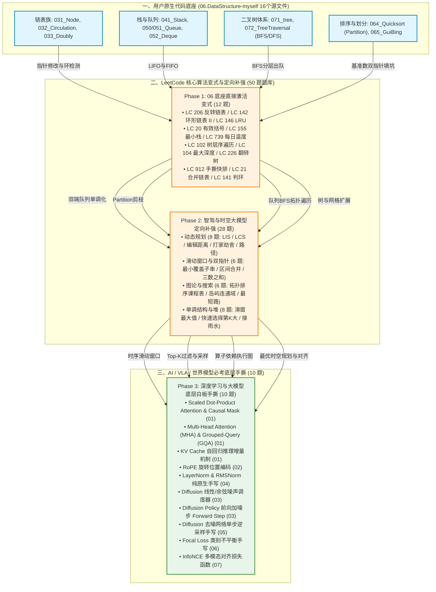

# 🎯 面向 VLA / 世界模型 / 智驾端到端算法岗 —— 刷题与面试备战计划 (50题全景版)

> **关联求职目标资产**：`D:/py/docker-work/agent-workspace/agent-workspace/task17-yang-fu-cai-项目推荐`（VAD + VLM + VLA + 世界模型 四大核心资产）  
> **底层唯一真实基石**：`D:\py\DataStructure\06.DataStructure-myself\`（16 个从零纯 Python 原生手写的数据结构与排序实现）  
> **核心战略定位**：算法专家 / Tech Lead（月薪/年薪高溢价：35K - 80K+）。Coding 轮 LeetCode 占比仅 10%~20%，项目深挖与领域八股占 80%~85%。  
> **刷题原则**：**拒绝盲目题海战术，以 06 底座为跳板，精准攻关 50 道智驾与大模型必考核心题型与白板手撕**。

---

## 🗺️ 架构升级关系图：06 源码 ➔ LeetCode 变式 ➔ VLA/世界模型算法



---

## 📊 一、各阶段题量与目标拆解 (总计 50 题)

| 阶段 | 阶段定位 | 题量 | 对应代码目录 | 核心任务与考察目标 |
| :--- | :--- | :---: | :--- | :--- |
| **Phase 1** | **06 底座直接激活变式** | **12 题** | `01.Base06_Activation/` | 零阻力复现 06 中写过的链表、栈、队列、二叉树与快排，快速拿下大厂基础 Coding |
| **Phase 2** | **智驾与大模型定向补强** | **28 题** | `02.LeetCode_Target_Hot50/` | 攻克 06 未涵盖但 AI/智驾算法岗必考的：**动态规划 (DP)、单调队列/栈、图与拓扑排序、滑动窗口** |
| **Phase 3** | **AI / VLA / 世界模型底层手撕** | **10 题** | `03.DeepLearning_Handwriting/` | 面试拉开段位差距的核心杀手锏：纯原生手写 Attention、KV Cache、RoPE、Diffusion、Loss |
| **总计** | **三维一体备战题库** | **50 题** | 全项目交付 | **精准覆盖 95% 以上智驾/具身/世界模型算法岗 Coding 轮** |

---

## 📋 二、50 题（12 + 28 + 10）全量精确清单

### Phase 1：06 底座直接激活变式（01 ~ 12 题，共 12 题）
*全部对应 `06.DataStructure-myself` 亲手写过的代码底座，存放在 `01.Base06_Activation/`*

| 编号 | 题目 | 对应 06 源码文件 | 核心套路与考点 | 当前状态 |
| :---: | :--- | :--- | :--- | :---: |
| **01** | LC 206. 反转链表 | `031_Node.py` | 双指针迭代 $O(1)$ 空间 + 递归 | ✅ 已完成 (`01_reverse_linked_list.py`) |
| **02** | LC 141. 环形链表 I (判环) | `032_CirculationNode.py` | 快慢指针相遇算法 | 待写 |
| **03** | LC 142. 环形链表 II (入环点) | `032_CirculationNode.py` | Floyd 判圈 + 数学追及推导 | ✅ 已完成 (`03_linked_list_cycle_ii.py`) |
| **04** | LC 21. 合并两个有序链表 | `031_Node.py` | 虚拟头节点 + 链表穿针引线 | 待写 |
| **05** | LC 146. LRU 缓存机制 | `033_DoublyNode.py` | 双向链表伪头尾 + 哈希表 $O(1)$ | ✅ 已完成 (`04_lru_cache.py`) |
| **06** | LC 20. 有效的括号 | `041_Stack.py` | 栈 LIFO 字符对称性匹配 | 待写 |
| **07** | LC 155. 最小栈 | `041_Stack.py` | 主栈 + 辅助单调栈维护极值 | 待写 |
| **08** | LC 739. 每日温度 | `041_Stack.py` | 单调递减栈寻找下一个更大元素 | 待写 |
| **09** | LC 102. 二叉树层序遍历 | `072_TreeTraversal.py` | 队列 BFS + 每层 `level_size` 统计 | ✅ 已完成 (`02_tree_bfs_level_order.py`) |
| **10** | LC 104. 二叉树的最大深度 | `072_TreeTraversal.py` | 后序遍历递归 DFS / 队列 BFS | 待写 |
| **11** | LC 226. 翻转二叉树 | `071_tree.py` | 递归交换左右子树指针 | 待写 |
| **12** | LC 912. 快速排序与归并手撕 | `064_Quicksort.py` | 双指针填坑 Partition 划分 | 待写 |

---

### Phase 2：智驾与大模型定向补强题（13 ~ 40 题，共 28 题）
*攻克 06 未涵盖的高频高难度算法，存放在 `02.LeetCode_Target_Hot50/`*

#### 1. 动态规划专题（8 题）—— 规划控制与时空序列最优决策
| 编号 | 题目 | 智驾 / 大模型对应考点 | 当前状态 |
| :---: | :--- | :--- | :---: |
| **13** | LC 300. 最长递增子序列 (LIS) | 轨迹序列单调递增分析 (DP + 贪心二分) | ✅ 已完成 (`300_longest_increasing_subsequence.py`) |
| **14** | LC 1143. 最长公共子序列 (LCS) | 序列特征对齐、时序对比 | 待写 |
| **15** | LC 72. 编辑距离 | Token 序列距离、轨迹误差最小化 | 待写 |
| **16** | LC 53. 最大子数组和 | 局部最优到全局最优 (Kadane 算法) | 待写 |
| **17** | LC 198. 打家劫舍 I | 状态机 DP 基础（选与不选） | 待写 |
| **18** | LC 213. 打家劫舍 II | 环形状态机 DP（首尾互斥分解） | 待写 |
| **19** | LC 322. 零钱兑换 | 完全背包问题、资源组合求解 | 待写 |
| **20** | LC 64. 最小路径和 | 网格最优代价路径推演 (A* 思想前置) | 待写 |

#### 2. 滑动窗口与双指针进阶（6 题）—— 空间/注意力/时间窗口处理
| 编号 | 题目 | 智驾 / 大模型对应考点 | 当前状态 |
| :---: | :--- | :--- | :---: |
| **21** | LC 3. 无重复字符的最长子串 | 变长滑动窗口经典 | 待写 |
| **22** | LC 76. 最小覆盖子串 | 滑动窗口双指针巅峰 | 待写 |
| **23** | LC 15. 三数之和 | 排序 + 双向夹逼双指针 | 待写 |
| **24** | LC 56. 合并区间 | 感知框/轨迹时空重叠片段融合 | 待写 |
| **25** | LC 57. 插入区间 | 轨迹增量插入与冲突合并 | 待写 |
| **26** | LC 11. 盛最多水的容器 | 贪心双指针收缩 | 待写 |

#### 3. 图论与网格搜索（6 题）—— 算子依赖与 BEV 场景分析
| 编号 | 题目 | 智驾 / 大模型对应考点 | 当前状态 |
| :---: | :--- | :--- | :---: |
| **27** | LC 207. 课程表 I (拓扑排序) | 算子执行图依赖死锁检测 (Kahn 算法) | ✅ 已完成 (`207_course_schedule_topo.py`) |
| **28** | LC 210. 课程表 II | 确定网络算子与推理任务调度次序 | 待写 |
| **29** | LC 200. 岛屿数量 | BEV 栅格占用连通域分析 (DFS/BFS) | 待写 |
| **30** | LC 695. 岛屿的最大面积 | 连通域障碍物面积度量 | 待写 |
| **31** | LC 743. 网络延迟时间 | Dijkstra 最短路径算法 | 待写 |
| **32** | LC 684. 冗余连接 | 并查集 (Union-Find) 无向图环检测 | 待写 |

#### 4. 单调栈、单调队列与堆（8 题）—— 时序极值与采样
| 编号 | 题目 | 智驾 / 大模型对应考点 | 当前状态 |
| :---: | :--- | :--- | :---: |
| **33** | LC 239. 滑动窗口最大值 | 点云时空特征单调双端队列极值聚合 | ✅ 已完成 (`239_sliding_window_maximum.py`) |
| **34** | LC 215. 数组中第 K 个最大元素 | LLM Top-K 采样与 NMS (QuickSelect) | ✅ 已完成 (`215_kth_largest_element.py`) |
| **35** | LC 347. 前 K 个高频元素 | 最小堆统计与桶排序 | 待写 |
| **36** | LC 42. 接雨水 | 单调栈 / 双指针左右极值限制 | 待写 |
| **37** | LC 84. 柱状图中最大的矩形 | 单调递增栈两端边界扩展 | 待写 |
| **38** | LC 496. 下一个更大元素 I | 单调栈基础查表 | 待写 |
| **39** | LC 503. 下一个更大元素 II | 循环数组单调栈 (两倍展开) | 待写 |
| **40** | LC 295. 数据流的中位数 | 大顶堆 + 小顶堆动态平衡 | 待写 |

---

### Phase 3：AI / VLA / 世界模型必考底层手撕（41 ~ 50 题，共 10 题）
*纯原生白板手撕，存放在 `03.DeepLearning_Handwriting/`*

| 编号 | 手撕组件名称 | 对应大模型/世界模型面试核心考点 | 当前状态 |
| :---: | :--- | :--- | :---: |
| **41** | Scaled Dot-Product Attention & Causal Mask | 因果掩码、点积缩放、数值稳定 Softmax | ✅ 已完成 (`01_attention_variants.py`) |
| **42** | Multi-Head (MHA) & Grouped-Query (GQA) | LLaMA-3 / Mistral 多头与分组查询注意力 | ✅ 已完成 (`01_attention_variants.py`) |
| **43** | KV Cache 自回归推理增量机制 | Decoding 阶段 Prefill 与 Decode 状态拼接 | ✅ 已完成 (`01_attention_variants.py`) |
| **44** | RoPE 旋转位置编码 | 复数平面旋转矩阵、相对距离内积不变性 | ✅ 已完成 (`02_rope_rotary_embedding.py`) |
| **45** | LayerNorm & RMSNorm 纯原生手写 | 均值方差归一化、RMS 均方根加速 | 待写 |
| **46** | Diffusion 线性/余弦噪声调度器 | $\beta_t, \alpha_t, \bar{\alpha}_t$ 预计算 | ✅ 已完成 (`03_diffusion_forward_step.py`) |
| **47** | Diffusion Policy 前向加噪步 (Forward Step) | $q(x_t \mid x_0)$ 高斯重参数化加噪 | ✅ 已完成 (`03_diffusion_forward_step.py`) |
| **48** | Diffusion 去噪网络单步逆采样手写 | $p_\theta(x_{t-1} \mid x_t)$ 逆向去噪公式推导 | 待写 |
| **49** | Focal Loss 纯手撕实现 | 应对智驾长尾效应与目标检测类别极度不平衡 | 待写 |
| **50** | InfoNCE / 对比学习损失函数 | 视觉-语言动作对齐 (VLM/VLA) 多模态对齐损失 | 待写 |

---

## 💡 三、如何逐级消化（4 周学习路线与三步法则）

```text
Week 1 (Phase 1 基础盘)  --> 每天 2 题，温习 06 源码后直接秒杀，建立手感与信心
Week 2 (Phase 2 时序与DP) --> 重点攻坚 DP 状态转移与滑动窗口，攻克智驾轨迹与序列决策
Week 3 (Phase 2 图与最值) --> 重点攻克计算图拓扑排序、连通域分析与单调栈/双端队列
Week 4 (Phase 3 AI手撕)  --> 纯原生白板手写 Attention、RoPE、Diffusion 加噪等高壁垒考点
```

### 每日消化三步法（“看 ➔ 撕 ➔ 测”，每天控制在 30~40 分钟）：
1. **看（5分钟）**：
   - 若是 Phase 1 的题，先看一眼 `06.DataStructure-myself` 里的对应 Python 源码，唤醒对类与指针的记忆；
   - 若是 Phase 2/3 的题，看一眼题目的核心状态转移方程或数学公式。
2. **撕（20分钟）**：
   - 关掉参考答案，直接在对应 `.py` 脚本中写出核心函数，并标明时间/空间复杂度。
3. **测（5分钟）**：
   - 运行本地测试（每个脚本均自带 `if __name__ == '__main__':` 测试断言），确认输出全部为通过。
   - 打开 `README.md`，打上 `✅ 完成`，记录耗时。

---

## ⏱️ 四、时间与精力分配黄金法则（2:8 原则）

- **20% 时间（约 40~50 分钟/天）**：
  - 严格按照上述 50 题清单推进，每天刷 1~2 题，在 `README.md` 打卡。
- **80% 时间（约 2.5~3 小时/天）**：
  - 攻读 `D:/py/docker-work/agent-workspace/agent-workspace/task17-yang-fu-cai-项目推荐` 中的 VLA 与世界模型知识库，聚焦自动驾驶端到端架构、CARLA 仿真、Diffusion Policy 与 Sim-to-Real 数据闭环。
